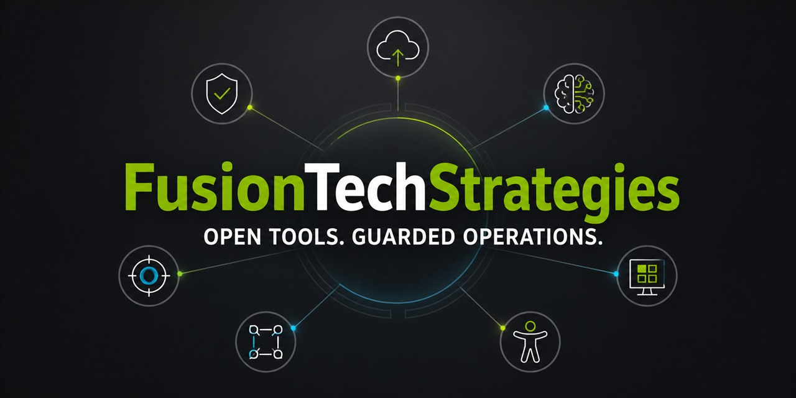

  

# Open-source defensive security and IT operations

Fusion Technology Strategies builds practical, evidence-first tools for incident response, AI security, Windows administration, cloud resilience, accessibility, and federal cloud operations.

The projects below are designed for operators who need to understand what a tool will do, test it safely, and retain useful evidence afterward. Each repository documents its guardrails, permissions, limitations, and validation approach.

## Start with the flagships

| Operator goal | Project | Maturity | Fastest meaningful evaluation |
| --- | --- | --- | --- |
| Investigate and contain a Microsoft 365 incident | [M365 Incident Response Console](https://github.com/fusiontechstrategies/M365-Incident-Response-Console) | Maintained public release | [Open the sanitized case report](https://github.com/fusiontechstrategies/M365-Incident-Response-Console/blob/main/examples/sanitized-case-report.md), then follow the [safe lab guide](https://github.com/fusiontechstrategies/M365-Incident-Response-Console/blob/main/docs/lab-evaluation.md). |
| Enforce local privacy and policy before optional Bedrock evaluation | [Bedrock Guardrail Firewall](https://github.com/fusiontechstrategies/Bedrock-Guardrail-Firewall) | Maintained public release | [Run the 60-second offline evaluation](https://github.com/fusiontechstrategies/Bedrock-Guardrail-Firewall#try-it-offline-in-60-seconds) and inspect the [sanitized demo](https://github.com/fusiontechstrategies/Bedrock-Guardrail-Firewall#reproducible-sanitized-demo). |
| Turn website and PDF findings into reviewable accessibility evidence | [WCAG 2.2 Site and PDF Scanner](https://github.com/fusiontechstrategies/WCAG-2.2-Site-PDF-Scanner) | Maintained public release | [View the synthetic report](https://github.com/fusiontechstrategies/WCAG-2.2-Site-PDF-Scanner/blob/main/examples/sample-report/report-preview.png) and run the [five-minute walkthrough](https://github.com/fusiontechstrategies/WCAG-2.2-Site-PDF-Scanner#five-minute-local-walkthrough). |

## Microsoft operations

- [Windows Admin Toolkit](https://github.com/fusiontechstrategies/Windows-Admin-Toolkit) is a maintained, signed-release toolkit for guarded local and remote administration. [Preview sanitized output](https://github.com/fusiontechstrategies/Windows-Admin-Toolkit/blob/main/examples/demo/README.md), review the [guarded automation flow](https://github.com/fusiontechstrategies/Windows-Admin-Toolkit#guarded-automation-lifecycle), or [download the signed release](https://github.com/fusiontechstrategies/Windows-Admin-Toolkit/releases/latest).

## Specialist and emerging tools

- [Fool's Gold](https://github.com/fusiontechstrategies/Fools-Gold) is an **offline pilot seeking infrastructure validation**, not a production-proven detection service. Run the [60-second synthetic exercise](https://github.com/fusiontechstrategies/Fools-Gold#try-it-in-sixty-seconds) and review exactly [what is and is not verified](https://github.com/fusiontechstrategies/Fools-Gold#what-is-verified-locally-and-what-is-not).
- [AWS Chaos Engineering Framework](https://github.com/fusiontechstrategies/AWS-Chaos-Engineering-Framework) is a maintained public release for reviewable, bounded AWS fault-injection planning and guarded extension workflows. Start with the [plan-only game-day walkthrough](https://github.com/fusiontechstrategies/AWS-Chaos-Engineering-Framework/blob/main/docs/PLAN_ONLY_GAME_DAY.md) or [PyPI 2.0.4](https://pypi.org/project/aws-chaos-engineering-framework/2.0.4/).
- [AWS GovHawk Efficiency Analyzer](https://github.com/fusiontechstrategies/AWS-GovHawk-Efficiency-Analyzer) is a **release candidate** for surfacing potential waste, security blind spots, and operational risk across AWS GovCloud services. It does not calculate realized savings or replace AWS Config, Security Hub, or workload-owner review.
- [IDS Rule Converter](https://github.com/fusiontechstrategies/IDS-Rule-Converter) is a maintained public release for converting and validating Snort and Suricata rules while refusing or separating ambiguous semantics. [Install PyPI 4.0.2](https://pypi.org/project/ids-rule-converter/4.0.2/) or inspect the [strict-versus-partial example](https://github.com/fusiontechstrategies/IDS-Rule-Converter#strict-and-reviewed-partial-results).
- [Ultra-Fast Proxy Fetcher & Tester](https://github.com/fusiontechstrategies/Ultra-Fast-Proxy-Fetcher-Tester) is a maintained network-diagnostics utility. It measures bounded reachability and latency; it does not establish that a proxy is trustworthy, anonymous, or appropriate for sensitive traffic. [Install PyPI 2.0.1](https://pypi.org/project/ultra-fast-proxy-fetcher-tester/2.0.1/).

## Supporting artifacts

- [PatchBlitz runtimes](https://github.com/fusiontechstrategies/Patchblitz-runtimes) publishes pinned, reproducible runtime archives used by the PatchBlitz Windows installer. It is a supply-chain support repository, not a standalone PatchBlitz product or end-user application.

Maturity labels describe the evidence available in each repository; they are not compliance certifications, warranties, or claims of customer adoption.

## Engineering principles

- **Safe before clever:** potentially disruptive actions are gated, scoped, and documented.
- **Evidence over adjectives:** projects include deterministic tests, sample outputs, and explicit limitations.
- **Auditable dependencies:** automated updates are reviewed, workflows use immutable action references, and protected branches require validation.
- **Operator ownership:** local and offline modes are available where the problem permits them; telemetry is not added to security or administration tools merely to count users.
- **Portable by design:** the primary runtime remains straightforward to inspect and move, even when optional package and integration layers are available.

The [security scanner operations record](SECURITY-OPERATIONS.md) documents portfolio schedules, ownership, exceptions, evidence retention, and the verification process.

## Feedback and security reports

Questions, reproducible bug reports, and implementation feedback are welcome in the relevant project. Please use each repository's `SECURITY.md` instructions for vulnerabilities instead of opening a public issue.

**First-use trials:** Windows administrators can try the [Windows Admin Toolkit no-change walkthrough](https://github.com/fusiontechstrategies/Windows-Admin-Toolkit/discussions/13); accessibility practitioners can try the [WCAG scanner synthetic walkthrough](https://github.com/fusiontechstrategies/WCAG-2.2-Site-PDF-Scanner/discussions/22). Each takes about 15 minutes, uses no customer data, and welcomes feedback on confusing steps.

For consulting and mission support, visit [https://www.fusiontsi.com](https://www.fusiontsi.com) or email jeff@fusiontsi.com.
